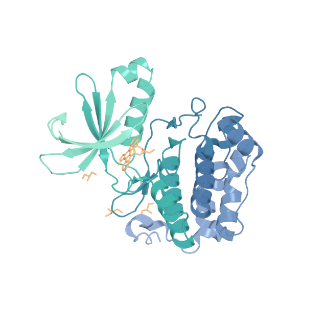

<div align="center">

# Pymol-VMD-X

**面向结构分析与科研制图的中文分子可视化工作台**

PyMOL 渲染内核、VMD 风格的分子选择和 ChimeraX 风格的工具栏。

[快速上手](#快速上手) · [使用手册](docs/USER_GUIDE.md) · [变更日志](CHANGELOG.md)



<sub>PDK1 结构 · PDB 1OKY</sub>

</div>

## 核心能力

- **科研制图**　识别蛋白与候选配体，提供期刊简约、卡通插画和通透表面三种风格。调整配色、光照与构图后，导出高分辨率 PNG。
- **分子选择与表示**　用 VMD 风格表达式或残基名快选定义显示范围，为不同组分独立设置卡通、棍状、球棍和颜色。
- **粗粒化结构与轨迹**　使用 Martini 拓扑模板显示 RNA、脂质等组分的连接，控制轨迹播放速度，检查不同帧的结构变化。
- **蛋白质翻译后修饰**　选择一个或多个位点，预览 Ser／Thr／Tyr 磷酸化和 Lys 的 L／D 乳酸化模型，生成独立对象并导出 PDB。

## 快速上手

已有桌面应用时，可直接打开 **Pymol-VMD-X**。从源码构建时，先安装所需的系统依赖，再在仓库根目录运行以下命令。 [构建依赖](INSTALL)

```bash
python3 -m venv .venv
source .venv/bin/activate
python -m pip install . PySide6
pymolx
```

1. **打开结构**　用「打开文件」加载结构，或将结构文件拖入窗口。
2. **选择组分**　点击对象旁的 **V**，用 `resname LIG` 等表达式选中配体，再分别调整显示方式和颜色。
3. **预览和导出**　在 **科研出图** 中选择风格，通过 **预览与导出** 调整视角和画面。

Martini 拓扑匹配、已有 PTM 识别、XTC 轨迹与周期边界处理见[使用手册](docs/USER_GUIDE.md)。

## 项目来源与许可

Pymol-VMD-X 是 Open-Source PyMOL 的独立衍生项目，由 xinyuren-bio 维护，OpenAI Codex 和 Cursor 参与开发协作。 [PyMOL 上游](https://github.com/schrodinger/pymol-open-source) · [开发说明](DEVELOPERS)

Copyright (c) [Schrodinger, LLC](https://www.schrodinger.com/)

PyMOL is a trademark of Schrödinger, LLC. [许可条款](LICENSE)
